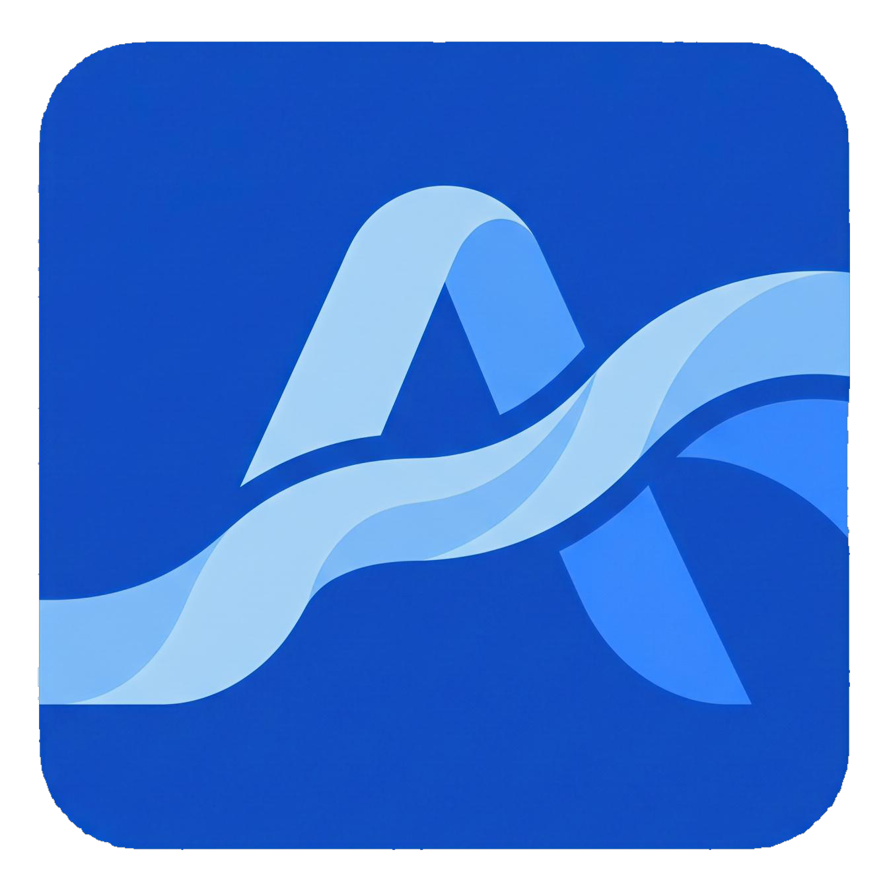

# 🌸 AlpTogether — Birleşik Ekosistem İstemcisi, Hibrit Kurulum & Onarım Merkezi

<p align="center">
  
</p>

<p align="center">
  <b>Tüm Alp Ekosistemi Uygulamalarını Tek Merkezden Keşfedin, İndirin, Hibrit Güncelleyin ve Tek Tıkla Onarın!</b><br/>
  <sub>C# (.NET 9 WPF) • 60 FPS Cyber-Pink Glass UI • Hibrit Kurulum Motoru • Anlık Hata Telemetrisi</sub>
</p>

<p align="center">
  <a href="https://github.com/alphankilicaslan/AlpTogether/releases/latest/download/AlpTogether.Setup.exe">
    
  </a>
  <a href="https://github.com/alphankilicaslan/AlpTogether/releases/latest">
    
  </a>
  
</p>

---

## 🚀 AlpTogether Nedir?

**AlpTogether**, geliştirilen tüm **Alp** ekosistemi uygulamalarını **Steam** ve **Riot Games Client** mimarisiyle tek bir çatı altında toplayan merkezi masaüstü istemcisidir. Uygulamaların kendisi istemci içerisine gömülü değildir; bulut kataloğu ([`catalog.json`](catalog.json) & Firebase Realtime Database) üzerinden canlı olarak senkronize edilir. Yeni bir uygulama geliştirildiğinde veya mevcut bir uygulamaya güncelleme yayınlandığında tüm kullanıcıların **AlpTogether** istemcisine anında düşer.

---

## 🧩 Alp Ekosistemi Uygulamaları

| İkon | Uygulama | Sürüm | Kategori | Kurulum Mimari Tipi | GitHub Deposu |
| :---: | :--- | :---: | :--- | :--- | :---: |
|  | **AlpNet Pulse** | `v2.2.4` | Ağ Hızlandırma, Cloudflare WARP & Canlı Ses Çevirisi | ⚡ **Hibrit Kurulum** (`AlpNet.Setup.exe` + Doğrudan Paket & `translator.exe`) | [AlpNet](https://github.com/alphankilicaslan/AlpNet) |
|  | **AlpFinans** | `v1.0.0` | Kişisel Finans, Vergi Analizi, Fatura & Birikim Simülatörü | 📦 **Doğrudan Paket** (`AlpFinans.exe` + `e_sqlite3.dll`) | [AlpFinans](https://github.com/alphankilicaslan/AlpFinans) |
|  | **AlphaGravity** | `v1.0.0` | Kurumsal Yapay Zeka, RAG Bilgi Bankası, 3B Grafik & Ses Köprüsü | 📦 **Doğrudan Paket** (`AlphaGravity.exe` + `WebView2Loader.dll`) | [AlphaGravity](https://github.com/alphankilicaslan/AlphaGravity) |
|  | **AlpRust+** | `v1.1.0` | Rust+ Akıllı Cihaz, Güvenlik Kamerası, Harita ve Raid Alarm Merkezi | ⚡ **Hibrit Paket** (`RustPlusDesk.exe`) | [AlpRustPlus](https://github.com/alphankilicaslan/AlpRustPlus) |
|  | **AlpLingo** | `v1.0.0` | Gerçek Zamanlı Yapay Zeka Ekran & Oyun Çevirici (AI OCR Overlay) | 🌐 **Doğrudan Paket** (`AlpLingo.exe` + NLLB-200 Çevrimdışı Motor) | [AlpLingo](https://github.com/alphankilicaslan/AlpLingo) |

---

## ✨ Öne Çıkan Özellikler

### 1. ⚡ 3 Modlu Hibrit Kurulum ve Güncelleme Motoru (`HybridInstallMode`)
Bazı uygulamaların kendi kurulum sihirbazı (`Setup.exe` / `.msi`) bulunurken bazıları doğrudan taşınabilir (`.exe` / `.zip`) yapıdadır. **AlpTogether** her iki yapıyı hibrit olarak destekler:
- **Birleşik Hibrit Mod (`HybridAuto`):** Kendi kurulum aracı olan uygulamaları `/auto` parametresiyle sessizce kurar, dinamik bulut bağlantılarını (`appstate.json`) çözümler ve ek bileşenleri (`translator.exe` vb.) doğrudan doğrulayıp senkronize eder.
- **Ayrı Kurulum Arayüzü (`StandaloneInstaller`):** Uygulamanın kendi `Setup.exe` kurulum penceresini bağımsız olarak açar, kurulumun tamamlanmasını izler ve kütüphaneye bağlar.
- **Doğrudan Dosya Senkronizasyonu (`DirectFiles`):** Kurulum sihirbazını atlayarak doğrudan yürütülebilir paketleri seçilen hedef klasöre indirir.

### 2. 🛠 Akıllı Hata Onarım ve Dosya Yolu Değiştirme
- **Tek Tıkla Onar & Doğrula:** Askıda kalan süreçleri sonlandırır, bozuk `.tmp` / `.old` kalıntılarını temizler, uygulama profillerini (ör. `AlpNet` WARP `wgcf-profile.conf` çakışması ve tarayıcı QUIC/HTTP3 politikaları) onarır, eksik `.exe` / `.dll` dosyalarını yeniden indirir ve masaüstü kısayolunu yeniler.
- **Dosya Yolu Değiştir & Taşı:** Kurulu bir uygulamayı tek tıkla başka bir diske veya klasöre taşır.

### 3. 🚨 Anlık Hata Telemetrisi (Auto-Crash Reporter) & Yardım Merkezi
- **Anlık Otomatik Hata Bildirimi:** Kullanıcılar istemcide veya başlatılan herhangi bir uygulamada çökme (`Crash` / `ExitCode != 0`) ya da kurulum hatası yaşadığında sistem **anında otomatik olarak** Firebase Realtime Database (`/alptogether/telemetry/errors`) ve Webhook üzerinden geliştiriciye hata raporu iletir.
- **Yardım & Sorun Bildir ("Bu Bozuk / Sıkıntı Var"):** Kullanıcılar hangi uygulamada hangi sorunu yaşadıklarını işlem loglarıyla birlikte doğrudan istemci içinden gönderebilir veya tek tıkla WhatsApp / GitHub destek hattına ulaşabilir.

### 4. ▤ Sonradan Değiştirilebilir Özel Boşluk & Canlı Log Konsolu
- Gerçek zamanlı, renk kodlu işlem ve telemetri log akışı ile ileride eklenecek modüller, özel duyurular veya geliştirici notları için dinamik **Modüler Özel Boşluk Alanı** içerir.

### 5. 🚀 Geliştirici Uygulama Yayınlama Stüdyosu
- Yeni geliştirdiğiniz bir uygulamayı veya mevcut bir uygulamanın yeni sürümünü istemci içindeki **Uygulama Yayınla** sekmesinden tek tıkla hem buluta hem de `catalog.json` dosyasına yayınlayabilirsiniz.

---

## 🛠 Derleme

Hem ana istemciyi (`AlpTogether.exe`) hem de GitHub Web Kurulum Aracını (`AlpTogether.Setup.exe`) tek komutla derlemek için:

```powershell
powershell -ExecutionPolicy Bypass -File .\Build_All.ps1
```

---

<p align="center">
  Geliştirici: <b>Alphan Kılıçaslan</b> • <a href="https://github.com/alphankilicaslan">@alphankilicaslan</a>
</p>
